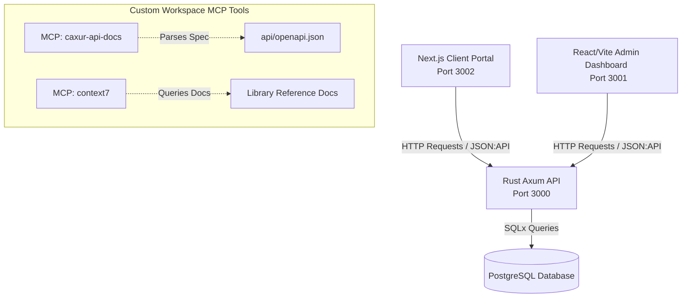

# 🤖 Caxur-FS AI Agent Developer Guide

Welcome to the **Caxur Full-Stack Monorepo (`caxur-fs`)**! This guide is designed to onboard and govern AI Agents, Assistants, and Pair-Programmers working in this repository. It details our architecture, strict coding standards, workflows, custom tools, and workspace-level MCP servers to ensure highly-polished, premium, and correct contributions.

---

## 🏗️ Monorepo Architecture Overview

The `caxur-fs` repository houses a robust, high-performance web application consisting of three primary services interacting with a PostgreSQL database:

### Services Summary:
1. **`client` (Next.js 16 / React 19.2, Port 3002)**: The public-facing client portal built with Tailwind CSS v4, Shadcn UI (`@base-ui/react` / `base-nova`), and Server-First principles.
2. **`admin` (React 19 + Vite 8, Port 3001)**: The back-office administrative panel utilizing Zustand, TanStack Query, Tailwind CSS v4, and Shadcn UI (`@base-ui/react` / `base-nova`).
3. **`api` (Rust 2024 + Axum 0.8 + SQLx 0.8, Port 3000)**: The core backend service adhering to Clean Architecture, Domain-Driven Design (DDD), and JSON:API v1.1 compliance.

---

## 🗃️ Workspace Agent Resources

All files related to AI Agent management, guidance, and tools are located in the `.agents/` directory (plus [`client/AGENTS.md`](client/AGENTS.md)):

- **`.agents/rules/`**: Target-specific system rules triggered by file patterns.
  - [`nextjs-client.md`](.agents/rules/nextjs-client.md): Rules for the Next.js 16 frontend client.
  - [`react-admin.md`](.agents/rules/react-admin.md): Rules for the Vite React 19 admin dashboard.
  - [`rust-axum-api.md`](.agents/rules/rust-axum-api.md): Rules for the Rust Axum 0.8 API.
- **`.agents/skills/`**: Rigid instructions, patterns, and interactive agent skills.
  - [`nextjs-client/SKILL.md`](.agents/skills/nextjs-client/SKILL.md): Bundled Next.js 16 docs (`client/node_modules/next/dist/docs/`), `src/proxy.ts`, RSC boundaries, URL syncing, `modern-web-guidance`, and Base UI rules.
  - [`react-admin/SKILL.md`](.agents/skills/react-admin/SKILL.md): Zustand stores, caching with React Query, URL search params sync, `modern-web-guidance`, and Base UI rules.
  - [`rust-axum-api/SKILL.md`](.agents/skills/rust-axum-api/SKILL.md): Layer isolation, Domain mapping, direct `JsonApiResponse` returns, `Qs<T>` pagination, Tokio/SQLx best practices, and OpenAPI spec sync.
  - [`setup-project/SKILL.md`](.agents/skills/setup-project/SKILL.md): Initial bootstrapping skill.
  - [`run-dev/SKILL.md`](.agents/skills/run-dev/SKILL.md): Development environment launch sequence.
  - [`verify-commit/SKILL.md`](.agents/skills/verify-commit/SKILL.md): Pre-commit verification and git push sequence.
  - [`bhu/SKILL.md`](.agents/skills/bhu/SKILL.md): Agent task creation, skill planning, and sub-agent allocation skill.
- **`.agents/plugins/`**: Custom workspace plugins exposing Model Context Protocol (MCP) servers.

---

## ⚙️ Custom Workspace MCP Tools, Bundled Docs & Pre-Flight Tools

To maximize efficiency and eliminate guessing, AI agents must leverage the workspace's registered MCP servers, bundled Next.js 16 docs, and `modern-web-guidance`:

### 🔌 1. `caxur-api-docs` MCP Server
- **Configuration**: [mcp_config.json](.agents/plugins/caxur-api-docs/mcp_config.json) (runs `scripts/mcp-api-docs.ts` via Bun)
- **Active Skill**: [api-docs-query SKILL.md](.agents/plugins/caxur-api-docs/skills/api-docs-query/SKILL.md)
- **Available Tools**:
  - `list_endpoints`: Returns all routes grouped by tags (Auth, Users, Roles, etc.).
  - `search_endpoints`: Performs keyword searches on endpoints (e.g., `query: "roles"`).
  - `get_endpoint_details`: Returns dereferenced schemas, parameters, responses, and security requirements.
  - `generate_typescript_types`: Generates complete, type-safe API helper functions and fetch interfaces.

> [!TIP]
> **Data Integration Flow**: When building pages in `client` or `admin`, **never hand-write types or routes**. Always run `search_endpoints` -> `get_endpoint_details` -> `generate_typescript_types` to integrate endpoints safely and programmatically. When modifying `api` routes or DTOs, register them in `api/src/presentation/openapi.rs` and run `cargo test --lib` to regenerate `api/openapi.json`.

### 📚 2. `context7` MCP Server
- **Active Skill**: [context7-docs SKILL.md](.agents/plugins/context7/skills/context7-docs/SKILL.md)
- **Available Tools**:
  - `resolve-library-id`: Maps framework or package names to specific identifiers.
  - `query-docs`: Returns targeted, up-to-date documentation on frameworks, APIs, and crates (e.g. Next.js 16, Axum 0.8, SQLx 0.8, Tailwind v4, React 19).

### 📖 3. Bundled Next.js 16 Docs & `modern-web-guidance`
- **Next.js 16 Bundled Docs**: Per [`client/AGENTS.md`](client/AGENTS.md), always consult `client/node_modules/next/dist/docs/` before writing Next.js 16 code, and use `/_next/mcp` (`next-devtools-mcp`) when the dev server is active.
- **`modern-web-guidance`**: Execute `npx -y modern-web-guidance@latest search "<query>"` -> `retrieve "<id>"` first for all HTML/CSS and client-side JS/UI tasks in `client/` and `admin/`, and include a `### Modern Web Guidance` disclosure section when consulted.

---

## 🔄 AI Agent Interactive Skills

AI agents should recommend these skills to the user, or execute their procedures directly:

### ⚙️ 1. `/setup-project` (Bootstrap Environment)
- Governed by [`.agents/skills/setup-project/SKILL.md`](.agents/skills/setup-project/SKILL.md).
- Runs [scripts/setup.sh](scripts/setup.sh).
- Checks/installs Bun, Cargo, and SQLx CLI.
- Automatically scaffolds `.env.local` (Client and Admin) and `.env` (API).
- Runs `bun install` to download dependencies.
- **Note**: Recommend the user to configure their own dev-containers for databases and infrastructure (see [damnyan/dev-containers](https://github.com/damnyan/dev-containers)).

### 🚀 2. `/run-dev` (Start Stack Concurrently)
- Governed by [`.agents/skills/run-dev/SKILL.md`](.agents/skills/run-dev/SKILL.md).
- Runs [scripts/run-dev.sh](scripts/run-dev.sh).
- Automatically kills dangling ports (`3000`, `3001`, `3002`, `5173`).
- Runs `cargo sqlx database setup` in `api/` and launches [`scripts/run-dev-orchestrator.ts`](scripts/run-dev-orchestrator.ts) via Bun to run API (`cargo watch`), Client, Admin (`bun run dev`), and the MCP Docs Inspector concurrently with a pinned status footer.
- Access points:
  - **API Service**: `http://localhost:3000`
  - **Admin Dashboard**: `http://localhost:3001`
  - **Client Portal**: `http://localhost:3002`
  - **MCP Docs Inspector**: `http://localhost:5173`

### 🧪 3. `/verify-commit` (Safe Verification & Commit)
- Governed by [`.agents/skills/verify-commit/SKILL.md`](.agents/skills/verify-commit/SKILL.md).
- Runs [scripts/verify-all.sh](scripts/verify-all.sh) to verify Client builds, Admin builds, SQLx preparation, API formatting, Clippy checks, and unit tests.
- **Autonomous Verification & Auto-Fix Loop**:
  - Enforces **zero build warnings** and **zero compilation errors** across all services (`--max-warnings 0` and `-D warnings`).
  - Automatically isolates root causes, applies fixes, and re-verifies in an iterative loop (capped at 5 attempts before escalating to the developer).
- **Dependency Upgrade Protocol**:
  - If resolving an error or deprecation requires a dependency update, the agent must research compatibility first (using `context7` MCP, release notes, changelogs, peer dependency checks).
  - Presents a structured **Pros & Cons** and compatibility report, prompting the developer for confirmation before modifying `package.json` or `Cargo.toml`.
- Analyzes changes and prompts the user with an interactive selector to:
  1. Commit and push (with high-quality Conventional Commit message).
  2. Commit only.
  3. Regenerate commit message.

### 📋 4. `/bhu` (Agent Task Creation & Planning via AGY `/plan`)
- Governed by [`.agents/skills/bhu/SKILL.md`](.agents/skills/bhu/SKILL.md).
- Combines the standard AGY CLI `/plan` workflow (structured implementation plan artifacts, GitHub alerts, component diffs, verification plans) with `caxur-fs` guardrails (skill matching, MCP server mapping, sub-agent allocation, and zero-warning/error build verification).

---

## 📐 Project Rules & Guardrails

Before modifying code, the agent MUST review the strict boundaries defined for each layer:

### 🛡️ 1. Rust Axum API (`api/`)
* **Layer Isolation**: Keep layers strict:
  $$\text{Domain (Traits, Entities)} \longleftarrow \text{Application (Use Cases)} \longleftarrow \text{Infrastructure (DB Models)} \longleftarrow \text{Presentation (Handlers, DTOs)}$$
  *No database or network-level code is allowed in Domain or Application.*
* **JSON:API v1.1 Compliance**:
  - Success responses must be wrapped in `ApiResponse` (`JsonApiResponse`) and returned directly **without** `axum::Json(...)` so `Content-Type: application/vnd.api+json` is preserved.
  - Never duplicate `id` or `type` inside resource `attributes`.
  - Relations requested via `?include=` MUST be placed in the top-level `included` array. Never inject relationships into primary `attributes`.
  - Pagination is mandatory on all list queries using `crate::shared::pagination::PageParams` (`page[number]` and `page[size]`) extracted via `crate::shared::query::Qs<T>` (never `axum::extract::Query<T>`).
* **Aggregations & Analytics**: Never reuse general resource listing endpoints for statistics or totals. Always create dedicated aggregation endpoints following the Dual-Pattern REST convention:
  - **Resource-Specific**: `GET /api/{resources}/statistics` (e.g., `GET /users/statistics`)
  - **Cross-Domain Dashboards**: `GET /api/analytics/{domain}` (e.g., `GET /analytics/dashboard`)
  Execute SQL aggregations (`COUNT`, `SUM`, `AVG`, `GROUP BY`) directly at the database layer via SQLx. Never fetch raw entity rows into application memory to compute summary stats.
* **Date Range Filters**: Any resource containing date/timestamp fields MUST support date range filtering parameters (`from` and `to` in ISO 8601 UTC with optional preset `period=7d|30d|90d|12m`) at the API layer.
* **Validation, Security & Error Sanitization**: Wrap parameters in `ValidatedJson` / `MaybeValidatedJson` (bounded to `MAX_JSON_BODY_BYTES`). Validation errors must trigger a `422 Unprocessable Entity` containing a JSON:API compliant error mapping the exact path with `source.pointer`. Never use `.unwrap()` / `.expect()` outside `#[cfg(test)]`, and never leak raw `sqlx::Error` or internal error strings in `500`/`503` responses. Invalidate `state.admin_permissions_cache` whenever roles, permissions, or admin role assignments change.
* **Rate Limiting**: Apply corresponding middleware per endpoint (and serve with `into_make_service_with_connect_info::<SocketAddr>()`):
  - **Auth/Strict**: `auth_rate_limit_layer` (default: 10/min).
  - **Public/Guest**: `public_rate_limit_layer` (default: 60/min).
  - **Private/Standard**: `api_rate_limit_layer` (default: 300/min).
* **Google Rust Style & Clippy Enforcement**: Place all `use` declarations at the top of the file; import types/traits directly and qualify free functions via their imported parent module (`use std::env; env::var(...)`). Wildcard imports (`use ...::*;` outside `#[cfg(test)]`), `&Arc<T>` / `&Arc<dyn Trait>` function parameters, speculative generics in application code, `Deref` polymorphism on newtypes, `catch_unwind`, `unsafe` blocks, and production `.unwrap()` / `.expect()` are strictly banned and enforced via `[lints]` in `api/Cargo.toml` + `api/clippy.toml`.
* **Testing**: Only write **Unit Tests** for core logic. DO NOT write integration tests.

### 🖥️ 2. Next.js Client Portal (`client/`)
* **Server-First & Next.js 16 Conventions**: Default to React Server Components (RSC). Keep `'use client'` boundaries as low and small as possible. Consult `client/node_modules/next/dist/docs/` before writing Next.js 16 code. Always `await` `params`, `searchParams`, `cookies()`, and `headers()`. Use `src/proxy.ts` (`export function proxy`) instead of deprecated `middleware.ts`.
* **URL Syncing & State**: **All** filters, paginated tables, search boxes, active tabs, and date range pickers MUST bind state directly to search parameters in the URL (`?page=1&search=term&from=...&to=...`). Do not store search/filter/date state in isolated local hooks. Debounce text inputs before pushing. (`useAuthStore` in `src/lib/auth-store.ts` is the sole permitted Zustand store).
* **Shadcn UI (`@base-ui/react` / `base-nova`) & React 19**: Use `render={<Link href="..." />}` (`nativeButton={false}`) instead of Radix's `asChild`, and pass `ref` as a standard prop (never `React.forwardRef`).
* **Analytics & Graphs**: Dashboards and analytics views MUST consume dedicated backend aggregation endpoints. Any page listing date-based resources MUST include date range picker controls. All graphs MUST be visually stunning, responsive, and provide interactive controls to toggle between compatible chart types (Line, Bar, Area, Donut, Pie).
* **Forms & Server Actions**: Always validate fields using React Hook Form combined with Zod schemas, and validate all `'use server'` action inputs with Zod on the server. Explicitly mark optional field labels with `(optional)`.
* **Notifications**: Standardize notifications using `sonner` (`toast.success` / `toast.error`). No native `window.alert` or `window.confirm`.
* **Dates & Times**: Always format dates using the shared `formatDateTime` utility to ensure time visibility.

### 👔 3. React Admin Portal (`admin/`)
* **Feature-Based Structure**: Organize files logically under features (e.g., `features/users/components/`).
* **State Boundaries**: Zustand is strictly reserved for *global client state* (sessions, layout toggles, theme). Use React Query (TanStack Query) exclusively for *server state* (data fetching, mutations, and caching).
* **Forms, Tables & JSON:API**: Strictly sync table pagination (`page`, `per_page`), filters, and date range pickers to the URL via `useSearchParams`. Pass `'page[number]'` and `'page[size]'` to JSON:API list endpoints and preserve top-level resource `id` (`{ ...r.attributes, id: r.id }`). Use Zod for form contracts.
* **Shadcn UI (`@base-ui/react` / `base-nova`) & React 19**: Use `render={<Element />}` (`nativeButton={false}`) instead of Radix's `asChild`, and pass `ref` as a standard prop (never `React.forwardRef`).
* **Analytics & Graphs**: Fetch dedicated analytics DTOs from statistics endpoints using TanStack Query. Render high-end aesthetic dashboard charts with dynamic chart type switching (Line, Bar, Area, Donut, Pie).
* **Notifications**: Use `sonner` toasts and Shadcn Dialogs / Alert Dialogs. No native UI confirmations.

---

## 🗑️ Temporary File & Lifecycle Policy

* **Clean Repository Guarantee**: If you create a temporary file, dry-run script, mockup, or test file in this directory to validate your changes, **you MUST delete it immediately** after verification to prevent cluttering the repository.
* **Commit Hook Execution**: Pre-commit verification is strictly checked. The `hooks.json` file triggers pre-tool script checks to ensure the monorepo always compiles clean.

---

*For detailed instructions on implementing design systems or writing domain logic, check the corresponding `SKILL.md` file in `.agents/skills/`.*
